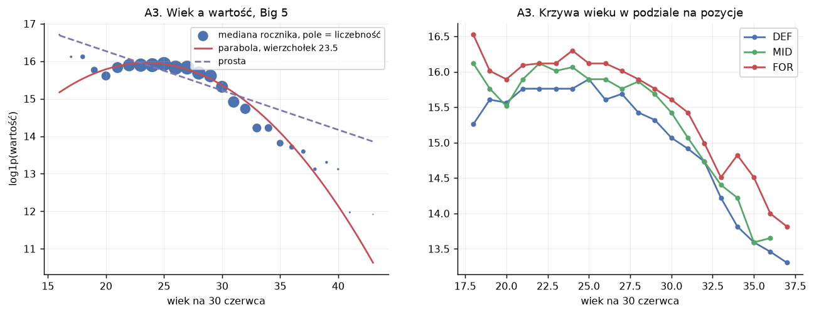

# trustml

**A framework for evaluating how far you can trust a machine learning model, not just how accurate it is.**

MSc thesis project, AGH University of Krakow (Computer Science – Data Science, defence planned for July 2027).
Status: work in progress. The data pipeline, validation protocol and baselines are done; reliability dimensions are being built stage by stage (see [Roadmap](#roadmap)).

> Polish version of this README: [README.pl.md](README.pl.md). Detailed project documentation in `docs/` is in Polish.

## The idea

A single accuracy score hides most of what matters once a model is used in practice. `trustml` takes any scikit-learn–compatible model and produces a standardised report across six dimensions:

| | Dimension | Question it answers | Main measure |
|---|---|---|---|
| W1 | Predictive accuracy | How close are the predictions? | RMSLE, MdAPE |
| W2 | Robustness | How much worse does it get when conditions change? | Degradation under domain shift and noise, split into bias and variance |
| W3 | Uncertainty | Does it know what it doesn't know? | Coverage and width of conformal prediction intervals |
| W4 | Explainability | Are its explanations stable? | SHAP importance + Kendall's tau across seeds and folds |
| W5 | Fairness | Is it equally accurate and unbiased across groups? | Per-group error gaps and mean residual (region, age, position, league) |
| W6 | Reproducibility | Can the result be recreated? | Metric spread across random seeds, complete run records |

The working hypothesis: **model rankings disagree across dimensions.** The most accurate model is not necessarily the most robust or the best calibrated. If that were false, R² would be enough. The main experimental result is a model × dimension matrix with rank correlations between dimensions.

## Case study: football player market values

The demonstration domain is predicting a player's Transfermarkt market value from match statistics (FBref), for the Big 5 European leagues.

- **Dataset:** 13,709 player-seasons × 114 columns, 5,310 players, seasons 2017/18–2023/24 (2019/20 excluded: Ligue 1 played only 279 of 380 matches).
- **Target:** `log1p(market value in EUR)`.
- **Temporal split:** train 2017/18–2021/22, calibration 2022/23, test 2023/24. A random split would put the same player in train and test, and market values are strongly correlated year to year.
- **Domain shift set:** the Portuguese Primeira Liga is held out entirely, to measure how the model behaves on a league it has never seen.
- **Hyperparameter tuning:** GroupKFold by player inside the training set only; the test set stays untouched.

### Preliminary results (stage E5, test set 2023/24)

| Model | RMSLE ↓ | R² (log scale) ↑ |
|---|---|---|
| M0a – global median | 1.27 | −0.05 |
| M0b – median per position × league | 1.17 | 0.10 |
| M1 – Elastic Net | 0.69 | 0.69 |
| M2 – Random Forest | 0.71 | 0.67 |
| M3 – XGBoost | 0.66 | 0.72 |
| M0c – last season's market value | 0.53 | 0.81 |

Two things worth stating openly:

- **Last season's value beats every model.** Models are deliberately denied the previous valuation, so they must learn from on-pitch statistics alone; M0c is a reference point, not a competitor. Its strength shows that Transfermarkt valuations are sticky and largely human-driven, which is also the conclusion of my bachelor's thesis on the same problem.
- **These numbers come from a short diagnostic tuning run** and will be refreshed after the full Optuna search. Every metric is also reported per league, position and "player seen in training vs. new player", because a single overall number hides large differences between those groups.



*From the exploratory analysis: market value peaks around age 23–25, and forwards are valued highest at almost every age. Figure labels are in Polish.*

## Engineering choices

- **Leakage protection as code:** `tests/test_no_leakage.py` checks that no player-season appears in two sets and that the Primeira Liga never reaches training or calibration.
- **Frozen evaluation protocol:** `configs/split.yaml` fixes seasons, grouping, metrics and the SHA-256 of the dataset it applies to. Changing the rules after seeing results is the quietest way to fool yourself.
- **Data provenance:** `data/processed/manifest.json` stores checksums of every input file, library versions, all parameters and row counts after each pipeline step.
- **Validated merges:** every join uses `validate=`. The previous version of this pipeline joined players by name without validation and silently produced 846 duplicated player-season pairs.
- **Decision log:** every non-obvious choice (metrics, deflation, back-transformation from log scale, etc.) is recorded with its reason in `docs/03-decyzje.md`.

## Project structure

```
src/trustml/            the library, domain-independent (metrics, splits, baselines, pipeline)
case_study/football/    data pipeline, EDA and modelling for the case study
configs/                frozen evaluation protocol
docs/                   project, data, decisions, plan, EDA write-up (Polish)
reports/                figures and result tables
tests/                  data, metric, pipeline and leakage tests
```

## Getting started

Requires Python 3.12+ and [uv](https://docs.astral.sh/uv/).

```bash
uv sync
uv pip install -e .
pytest            # data-dependent tests are skipped if the dataset is absent
```

Raw data is not included. FBref match data (`data/raw/fbref/master.db`) and Transfermarkt valuations from the Kaggle dataset [`davidcariboo/player-scores`](https://www.kaggle.com/datasets/davidcariboo/player-scores) (`players.csv`, `player_valuations.csv` in `data/raw/tm/`) are needed to rebuild the dataset:

```bash
python -m case_study.football.przygotuj_dane       # build the modelling dataset
python -m case_study.football.uruchom_eda          # exploratory analysis (~10 s)
python -m case_study.football.poziom_odniesienia   # baselines M0a–M0c
python -m case_study.football.modelowanie          # tune and evaluate M1–M3
```

## Roadmap

| Stage | Scope | Status |
|---|---|---|
| E1 | Data pipeline | ✅ |
| E2 | Provenance manifest, tests, imports | ✅ |
| E3 | Exploratory data analysis | ✅ |
| E4 | Validation protocol and baselines | ✅ |
| E5 | Models M1–M3, accuracy (W1) | in progress |
| E6 | `trustml` 0.1: library skeleton, W1, W6 | planned |
| E7 | Robustness (W2) | planned |
| E8 | Uncertainty (W3) | planned |
| E9 | Explainability (W4) | planned |
| E10 | Fairness (W5) | planned |
| E11 | Domain shift: Primeira Liga | planned |
| E12 | `trustml` 1.0 and synthesis | planned |

## Stack

Python 3.12, pandas, NumPy, scikit-learn, XGBoost, Optuna, SciPy, Matplotlib, PyArrow, pytest, ruff, pre-commit, uv.

## Author

Wojciech Niemiec · [LinkedIn](https://www.linkedin.com/in/wojciechniemiec) · supervised at AGH University of Krakow
